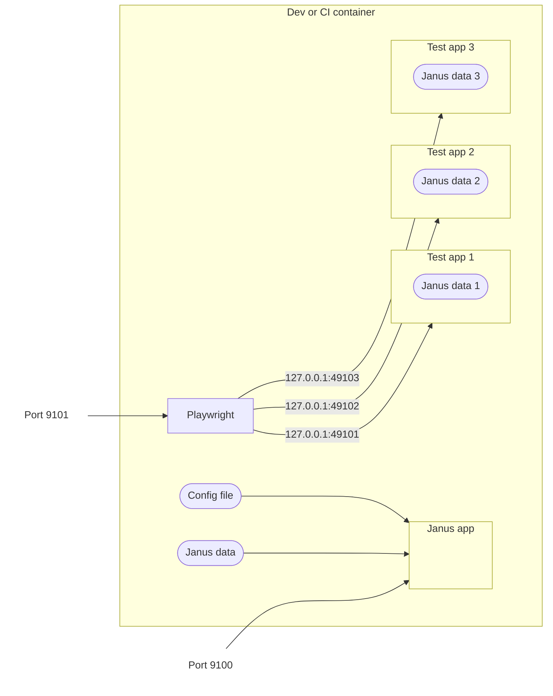
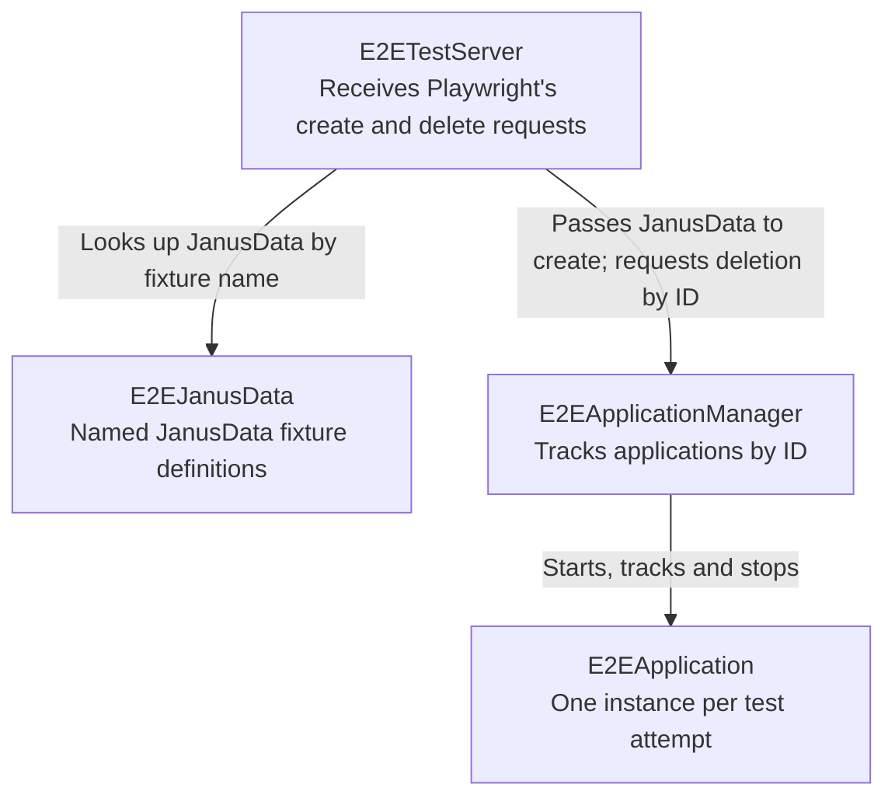

# End-to-end tests

Run the Playwright E2E tests from the repository root:

```shell
mise exec -- npm --prefix frontend run test:e2e
```

The npm script builds the frontend assets and runs Playwright using the
test-only `E2ETestServer`, both locally and in CI. The server manages
a fresh application on its own loopback port for every test attempt, including
retries and UI reruns. Browser tests use their application's URL,
not port 9102. The E2E tests bypass Google auth.

The isolated test app can run alongside the Janus development app on port 9100
and the Playwright UI on port 9101. Playwright deliberately does not reuse an
existing server on its test port and stops its server when the tests finish.

Local npm runs and the separate `e2e-tests` CI job use the same real application
in Play's test mode, with test-only signing/auth setup. Test mode serves the
built frontend assets without a development HTTPS proxy. Application instances
are stopped after each test, including failures; E2EApplicationManager stops any remaining
instances when Playwright shuts it down.
Application creation, deletion and shutdown are serialised by E2EApplicationManager;
browser tests run in parallel against their independent applications.

## Why use this setup?

Each test needs a clean copy of Janus with known test data. For example, one
test needs a list of accounts, while another needs a current support slot.
The tests must not change each other's application state.

This setup gives each test a fresh Janus application. The applications share
one Java process, but each has its own application state, test data and port.
This means:

- Tests can use different `JanusData` at the same time.
- Tests do not depend on which test ran first. Retries and UI reruns also get
  fresh applications.
- Browser tests can run in parallel, rather than wait for one shared application.
- Each test does not need to start a new Java process.
- Tests use the real Janus pages and application code, with fixed test data.
- Applications are stopped after use. The manager also stops any that remain
  when the test server shuts down.

### Why not use a simpler option?

| Option | What this setup does better |
| --- | --- |
| One application for all tests | Each test gets its own application state, even when tests use the same data fixture. |
| One shared application, reset before each test | Tests can run in parallel without one test resetting another test's application. |
| A separate Java process for every test | One shared Java process avoids repeated Java process startup and its extra memory cost. |

The cost is extra test code to create, track and stop applications. Each
application still takes time and memory to start, and application creation is
serialised. Only the browser tests run in parallel.

This is application-state isolation, not complete isolation. The applications
share a Java process, so they share process-wide resources. This setup does not
give each test a separate DynamoDB database or test real AWS federation.

## Per-test fixtures

Each test uses `fixtures.js` to request its own application. HTTP connects
Playwright's Node.js process to the Scala test server. All test applications
run in one JVM, but each has its own local port and selected `JanusData`.



The test application ports shown are examples; each application uses a dynamically
allocated loopback port.

### Relationships between Scala test classes

`E2EJanusData` supplies data.  
`E2ETestServer` selects that data and passes it to `E2EApplicationManager`.  
The manager starts an `E2EApplication` with that data and returns its ID and URL to the test server.  
Each application has separate application state and its own loopback port.

All four run in the same JVM:



### How does Playwright know which port to connect to?

The test server returns the application's URL. Playwright does not need to
discover the port:

1. Before each test, [`fixtures.js`](../frontend/e2e-tests/fixtures.js) sends
   `POST /instances` to `http://127.0.0.1:9102`, with the selected `JanusData` fixture name.
2. `E2EApplicationManager` starts a fresh application. `E2ETestServer` returns
   JSON with its `id` and `baseURL`, for example `http://127.0.0.1:49101`.
3. The fixture reads that response and sets Playwright's `baseURL` for that test
   to `app.baseURL`. This overrides the value in `playwright.config.js`.
4. A call such as `page.goto("/accounts")` uses that URL, so the browser connects
   to `http://127.0.0.1:49101/accounts`.

Port `9102` is only for application management. Browser requests go directly to
the test application's port. Each test receives its own URL.

Application creation is serialised but browser tests run in parallel against
their separate applications. After each test, `fixtures.js`
sends `DELETE /instances/{id}` to `E2ETestServer`. The server asks
`E2EApplicationManager` to stop that test's `E2EApplication`, including when the
test fails.

### Selecting JanusData

Tests import `test` and `expect` from `frontend/e2e-tests/fixtures.js` rather than
directly from Playwright. Select a Scala-defined `JanusData` fixture with
`test.use` in a spec or `test.describe` group:

```javascript
import { expect, test } from "./fixtures.js";

test.use({ janusData: "accounts-list" });

test("shows the accounts page", async ({ page }) => {
  await page.goto("/accounts");
  await expect(page).toHaveTitle("Accounts - Janus");
});
```

Add or change entries in [`E2EJanusData.fixtures`](../test/e2e/E2EJanusData.scala)
using the project's Scala DSL.

These fixtures cover offline UI behaviour, not real AWS federation or isolated
DynamoDB state. Each test attempt gets a fresh
application with the selected immutable `JanusData` injected directly.
So tests can share a fixture definition and run independently in parallel.

Shared application settings live in `test/resources/e2e.conf`, including
federation mappings, disabled passkeys and disabled developer-policy fetching.

## Playwright UI

To use the Playwright UI, run from the repository root:

```shell
mise exec -- npm --prefix frontend run test:e2e:ui
```

The UI script uses the same asset build and isolated server as `test:e2e`.
