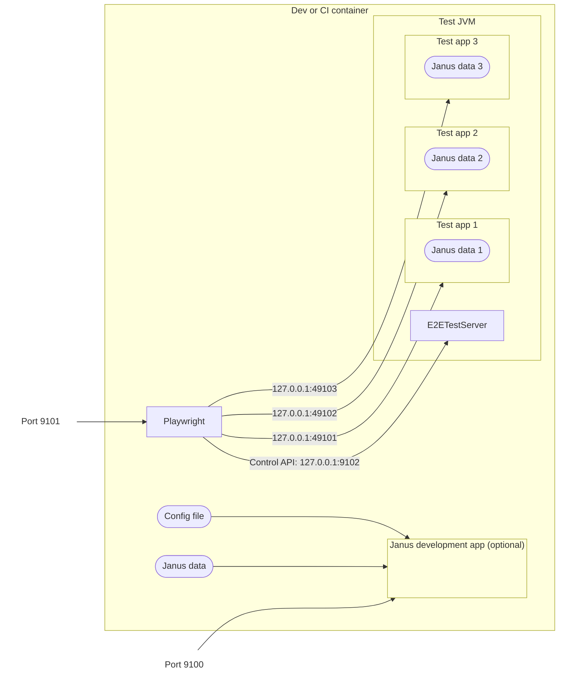

# End-to-end tests

Run the Playwright E2E tests from the repository root:

```shell
mise exec -- npm --prefix frontend run test:e2e
```

Local runs and the `e2e-tests` CI job build the frontend assets and start the
test-only `E2ETestServer` on port 9102. The tests use the real Janus application
in Play's test mode, with test-only signing and Google auth bypassed. No local
application configuration, Docker or development HTTPS proxy is needed.
Playwright does not reuse an existing server on its test port and stops its
server when the run ends.

The `CI` environment variable enables `forbidOnly` (rejecting `test.only`),
two retries and the GitHub and HTML reporters. It does not change the
application or port.

## Why use this setup?

Each test attempt, including retries and UI reruns, gets a fresh Janus
application with its own application state, test data and loopback port.
The applications share one JVM, so tests use real Janus pages and application
code without starting a separate Java process for every test.

| Option | What this setup does better |
| --- | --- |
| One application for all tests | Each test gets its own application state, even when tests use the same data fixture. |
| One shared application, reset before each test | Tests can run in parallel without one test resetting another test's application. |
| A separate Java process for every test | One shared JVM avoids repeated process startup and its extra memory cost. |

The trade-off is extra code to create, track and stop applications.
Application creation, deletion and shutdown are serialised, but browser tests
can run in parallel. This is application-state isolation, not process or
database isolation: the apps share JVM-wide resources and do not get separate
DynamoDB databases.

## Per-test applications

Playwright's Node.js process requests applications over HTTP. Browser traffic
goes straight to each application's port. The test apps can run alongside the
development app on port 9100 and the Playwright UI on port 9101.



The test application ports shown are examples; each application uses a
dynamically allocated loopback port.

### Relationships between Scala test classes

All four run in the same JVM as the Janus Play app:


### How does Playwright know which port to connect to?

1. Playwright waits for `/healthcheck` on port 9102. When a test requires an
   application, [`fixtures.js`](../frontend/e2e-tests/fixtures.js) sends
   `POST /instances` to `http://127.0.0.1:9102` with the selected fixture name.
2. `E2EApplicationManager` starts a fresh application. `E2ETestServer` returns
   its `id` and `baseURL` as JSON.
3. The fixture sets that test's `baseURL` to the returned URL. A relative
   navigation such as `page.goto("/accounts")` goes directly to that app.
4. After the test, even if it fails, the fixture sends `DELETE /instances/{id}`
   for each application it created. The manager stops any remaining
   applications when the test server shuts down.

## Selecting JanusData

Tests import `test` and `expect` from `./fixtures.js` rather than directly
from Playwright. The default fixture is `index-permission`. Select another
Scala-defined fixture with `test.use` in a spec or `test.describe` group:

```javascript
import { expect, test } from "./fixtures.js";

test.use({ janusData: "accounts-list" });

test("shows the accounts page", async ({ page }) => {
  await page.goto("/accounts");
  await expect(page).toHaveTitle("Accounts - Janus");
});
```

Add or change entries in [`E2EJanusData.fixtures`](../test/E2EJanusData.scala)
using the project's Scala DSL. 
Each application receives its selected immutable `JanusData` directly, so
tests can share a fixture definition and still run independently. There are
no generated config files or extra scenario registrations.

Shared settings live in [`e2e.conf`](../test/resources/e2e.conf), including
the federation mappings and settings that disable passkeys and developer-policy
fetching. Fixture account keys need matching federation mappings. The
checked-in fixtures use synthetic identities and deny-all policies. The
support fixture puts `dev-user` in a slot starting on 2 November 2026 with
no successor, so it does not expire.

These fixtures cover offline UI behaviour, not real AWS federation. Keep the
console and credentials navigation interception in tests; DB-backed or
real-AWS scenarios need separate test infrastructure.

## Playwright UI

Run from the repository root:

```shell
mise exec -- npm --prefix frontend run test:e2e:ui
```

The UI script uses the same asset build and isolated server as `test:e2e`.
Open `http://127.0.0.1:9101/` rather than `/trace/uiMode.html` directly:
the redirect supplies the WebSocket connection details needed to load tests.
